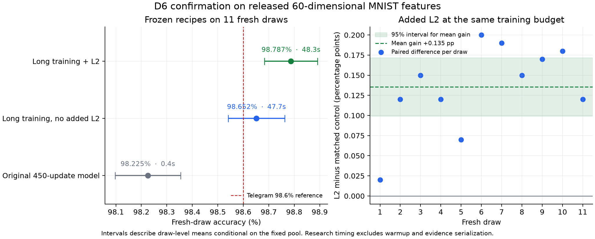
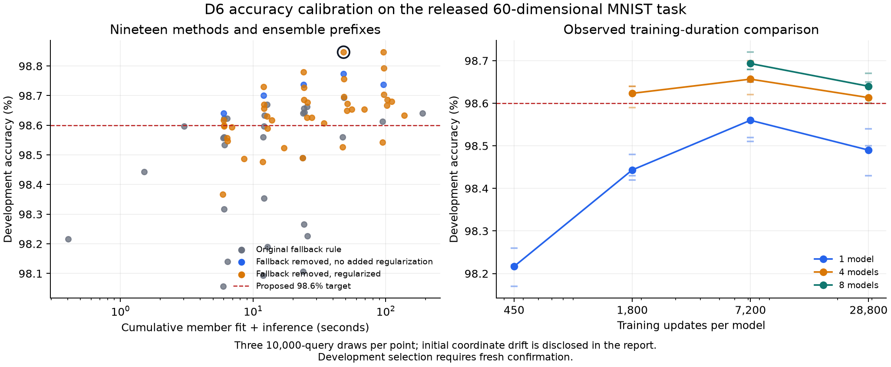

# D6 accuracy research 22 October 2026

The frozen `noguard_l2_1em3_7200` ensemble (8 members) achieved **98.787%** (108666/110000) on eleven fresh released MNIST draws; the approximate 95% draw-level t interval is **[98.683, 98.892]%**. Mean / maximum measured algorithm time was **48.268 / 48.584 seconds per draw**. It met the exploratory 98.6% target within the frozen research budget. This is an achieved operating point among tested methods, not an established accuracy ceiling.

**Regularization effect:** `selected` minus `matched_unregularized_control` was **0.135 percentage points**, with approximate 95% paired draw-level interval **[0.099, 0.172]**. This supports a gain for this specific regularizer. The selected learner is the regularized comparison. The matched control preserves training duration, width, guard and ensemble size, removing only explicit matrix L2, hidden dropout, hidden-encoder DropConnect or extra Gaussian noise as recorded in the frozen plan.

**D6 proposal:** 98.7% accuracy (at most 1.3% error) is a plausible next target. This frozen eleven-draw group clears it by 96 predictions; it misses 98.8% by 14 predictions. The approximate mean-accuracy interval still includes 98.7%, so this is calibration evidence, with three complete sandboxed qualification groups still needed before activating a new level. The selected recipe uses about 48 seconds, leaving much of the five-minute research budget unexplored; the highest attainable accuracy remains unknown.

## Fresh confirmation

| Frozen role(s) | Correct / total | Accuracy | Approximate95% draw interval | Mean / maximum algorithm seconds | Audit |
|---|---:|---:|---:|---:|---|
| selected | 108666/110000 | 98.787% | [98.683, 98.892] | 48.268 / 48.584 | valid |
| baseline450 | 108048/110000 | 98.225% | [98.097, 98.354] | 0.404 / 0.408 | valid |
| matched_unregularized_control | 108517/110000 | 98.652% | [98.541, 98.763] | 47.690 / 48.000 | valid |

Intervals use eleven paired draw-level observations, conditional on this fixed MNIST pool and frozen procedure. Overlapping query images do not constitute 110000 independent Bernoulli trials. The source, prefix, roles and draw seeds were frozen before the fresh inputs were prepared; no confirmation-based reselection is allowed.

## Development screen

Terminal outcomes retained: **19/19**. Initial ten arms used three development draws. The adaptive nine-arm no-guard extension reuses those seeds, with 7200 steps, sixteen sequential members and prefixes 1/2/4/8/16; all plan amendments are retained. A candidate must stay within 300 seconds on every development draw. The ranking selects pooled correct count, then mean reported call time; selected development accuracy is optimistic and is kept separate from fresh confirmation.

| Arm | Phase | Best eligible prefix | Correct / total | Accuracy | Mean / maximum budget seconds |
|---|---|---:|---:|---:|---:|
| baseline450 | development | 1 | 29465/30000 | 98.217% | 0.403 / 0.403 |
| long1800 | development | 4 | 29587/30000 | 98.623% | 6.021 / 6.022 |
| long7200 | development | 8 | 29608/30000 | 98.693% | 48.347 / 48.372 |
| l2_7200 | development | 2 | 29506/30000 | 98.353% | 12.107 / 12.108 |
| dropout7200 | development | 2 | 29601/30000 | 98.670% | 12.737 / 12.745 |
| dropconnect7200 | development | 4 | 29593/30000 | 98.643% | 24.420 / 24.519 |
| l2_dropout7200 | development | 4 | 29468/30000 | 98.227% | 25.752 / 25.753 |
| noise7200 | development | 4 | 29432/30000 | 98.107% | 23.740 / 23.763 |
| teacher_taper7200 | development | 4 | 29592/30000 | 98.640% | 23.756 / 23.759 |
| long28800 | development | 8 | 29592/30000 | 98.640% | 189.496 / 189.513 |
| noguard7200 | development-extension | 8 | 29632/30000 | 98.773% | 48.067 / 48.188 |
| noguard_l2_1em4_7200 | development-extension | 16 | 29638/30000 | 98.793% | 96.404 / 96.411 |
| noguard_l2_1em3_7200 | development-extension | 8 | 29654/30000 | 98.847% | 48.085 / 48.095 |
| noguard_dropout_01_7200 | development-extension | 16 | 29606/30000 | 98.687% | 102.664 / 102.669 |
| noguard_dropout_02_7200 | development-extension | 16 | 29600/30000 | 98.667% | 101.825 / 101.837 |
| noguard_dropconnect_01_7200 | development-extension | 16 | 29611/30000 | 98.703% | 96.978 / 97.018 |
| noguard_width1024_dropout_01_7200 | development-extension | 16 | 29604/30000 | 98.680% | 110.651 / 110.687 |
| noguard_width1536_dropout_01_7200 | development-extension | 8 | 29596/30000 | 98.653% | 68.658 / 69.131 |
| noguard_noise7200 | development-extension | 16 | 29563/30000 | 98.543% | 94.726 / 94.729 |

## Method and interpretation

The variants derive from spartanhaden’s PR #139 kernel-taught Ladder: its learned teacher supplies transformed features and soft targets to the student, followed by the inherited hidden-space HKNN correction. The study varies training duration, probability ensembles, matrix L2, hidden dropout, hidden-encoder DropConnect, Gaussian noise and first-hidden-layer width. Each member is fitted from the supplied draw. The learner receives only train inputs, train labels and query inputs; the outer controller retains query truth.

The original guard can substitute teacher probabilities when training errors exceed 40 or class disagreements cross its threshold. Stronger regularization often activates it, so the extension removes the final substitution while retaining teacher features, soft targets and HKNN. Matrix L2 adds `(lambda/2)*sum(weight**2)` to encoder/decoder matrices only. Dropout and DropConnect operate only during training. These comparisons measure the specified interventions rather than all possible regularization.

Initial `dropout7200` and `long28800` have released-coordinate hashes different from the other initial arms, with matching query labels. They remain retained, and those initial comparisons are not claimed to be byte-exact paired inputs. Extension and confirmation instead share frozen per-seed NPZ arrays, checked before use. Initial timing counts member `_predict` calls; future `cumulative_algorithm_seconds` also includes synchronized probability accumulation and argmax. Both exclude draw preparation, warmup, truth comparisons and evidence transfer/serialization.

The five-minute research budget differs from the stock scorer’s 60-second per-call watchdog. This study changes no competition rules and supplies no official D6 score, energy, sandbox warmup or foreign-data qualification. Source files use the research `_predict(...) -> (probabilities, training_errors)` interface and are not established as label-only submission entrypoints. The research source for matched_unregularized_control is 25,474 bytes, exceeding the official 20,480-byte source cap. Public evidence consists of marked excerpts with labels, counts, timing and hashes; omitted probability payloads and input NPZs remain in the complete local archive. The public verifier replays excerpt counts and integrity; retained local audits additionally check probability averaging and array bytes. Controller chronology and infrastructure limitations are recorded in provenance.

## Sources and evidence

- Algorithm: [PR #139](https://github.com/cybertronai/sutro-problems/pull/139), preserving its direct and inherited credits; contributor list is retained in provenance.
- Discussion: [longer training and ensembles](https://t.me/sutro_group/2993/3186), [regularization request](https://t.me/sutro_group/2993/3198). These discussion claims are motivation, not independent measurements in this report.
- [Plans](plan.json), [extension amendments](extension-plan.json), [development audit](analysis.json), [provenance](provenance.json).
- [Public evidence inventory](evidence-manifest.json), [publication policy](publication-policy.json), [public verifier](verify_public_evidence.py). Run `python verify_public_evidence.py` in this package.
- [Frozen confirmation plan](confirmation-plan.json), [fresh-confirmation audit](confirmation-analysis.json).

[Competition review: four merged PRs and seven held submissions](../../reviews/20261022/README.md)
